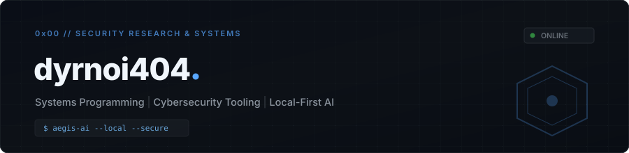

  

 

### ⚡ About Me

Software engineer & security researcher focusing on **local-first cybersecurity tooling**, **Linux systems**, and **privacy-preserving architectures**. 

* 🔭 **Current Work:** Core developer of [AEGIS AI](https://github.com/dyrnoi404/aegis-ai) - a private, local-first cybersecurity intelligence workstation.
* 🧠 **Interests:** Systems internals, defensive security tooling, network telemetry analysis, and autonomous AI agents.
* ⚙️ **Philosophy:** Minimalist workflows, privacy by design, and reliable command-line tooling.

---

### 🛡️ Featured Project

<table>
  <tr>
    <td>
      <h3><a href="https://github.com/dyrnoi404/aegis-ai">🛡️ AEGIS AI</a></h3>
      
<b>Private, local-first cybersecurity intelligence workstation & assistant.</b>

      
A self-contained workstation designed for security teams and researchers to inspect telemetry, triage logs, and run local AI-assisted security analysis without exfiltrating sensitive data to third-party APIs.

      

        
        
        
        
      

    </td>
  </tr>
</table>

---

### 🛠️ Tech Stack & Tooling

| Domain | Stack |
| :--- | :--- |
| **Languages** | Python, Bash / Shell, C, JavaScript, SQL |
| **Security & Research** | Linux Internals, Network Packet Analysis, Nmap, Wireshark, Burp Suite |
| **Infrastructure & Ops** | Docker, Git / GitHub, Kali Linux, Debian, REST APIs |

 

---

### 📈 Contribution Stream

<picture>
  <source media="(prefers-color-scheme: dark)" srcset="https://raw.githubusercontent.com/dyrnoi404/dyrnoi404/output/github-contribution-grid-snake-dark.svg">
  <source media="(prefers-color-scheme: light)" srcset="https://raw.githubusercontent.com/dyrnoi404/dyrnoi404/output/github-contribution-grid-snake.svg">
  
</picture>

---

### 📊 GitHub Activity

  
  

 

---

  Open to collaboration on security tooling & local AI · <a href="https://t.me/not_mudota">Ping me on Telegram</a>

